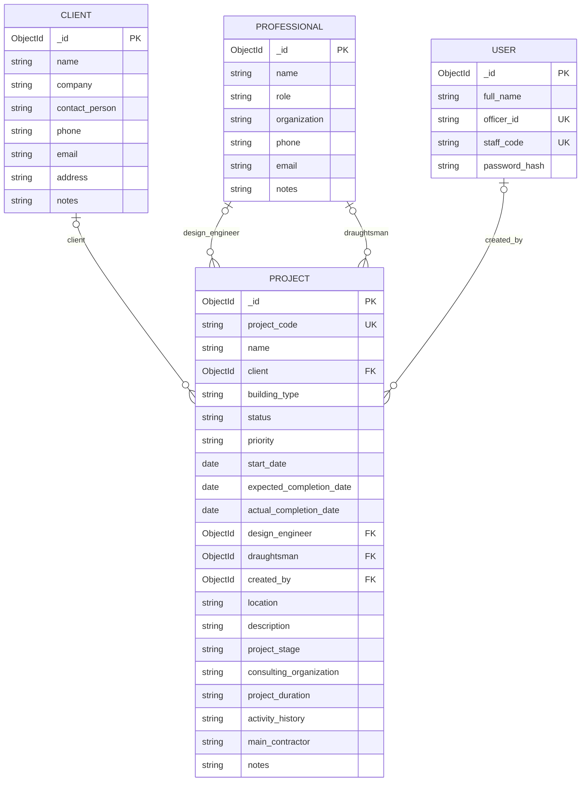

# Database design (ER diagram)

MongoDB collections and how they are linked. A link stores the `_id` of a document in another collection.

Notes
* One client can have many projects. One professional can work on many projects (as design engineer or draughtsman).
* The links are optional. If a client or professional is deleted, the API sets that link to `null` on its projects. The projects are not deleted.
* Every document also has `created_at` and `updated_at` (added by Mongoose).
* Not built yet: drawings, site visits, tenders, material approvals, testing, payments. Each would link to a project.
