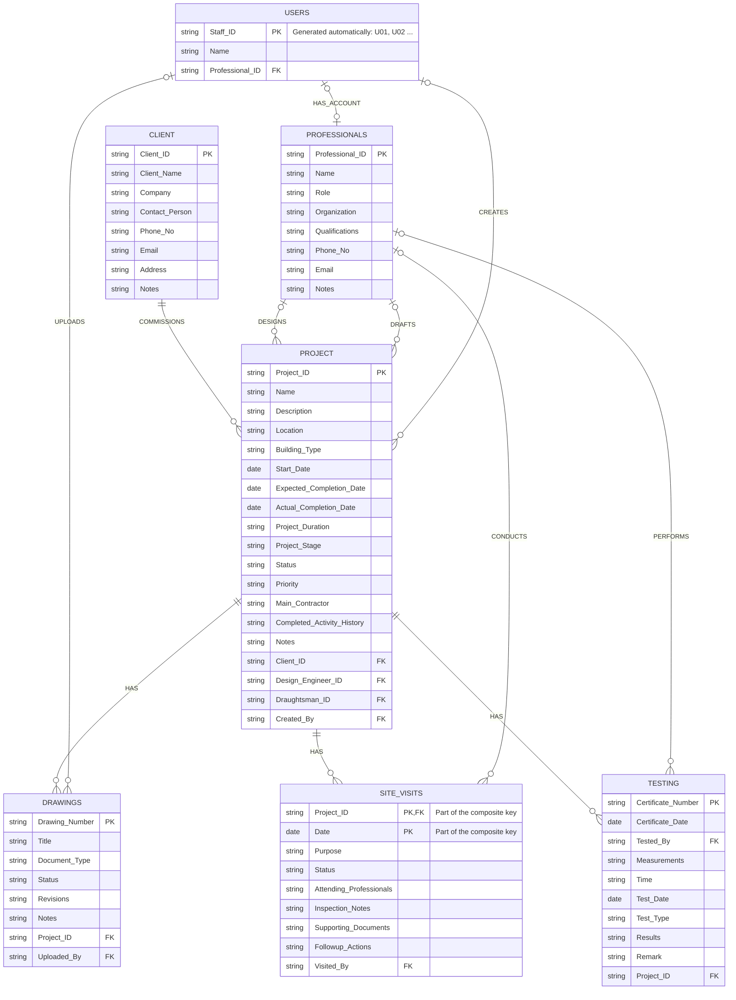

# Entity Relationship Diagram (VoltEdge)

The system has seven entities: PROFESSIONALS, USERS, PROJECT, CLIENT, DRAWINGS, SITE_VISITS and TESTING.
In MongoDB, a link between two entities is stored as the `_id` of a document in the other collection.

## Relationships

| Relationship | Entities | Meaning |
|---|---|---|
| COMMISSIONS | CLIENT 1 : N PROJECT | A client commissions many projects. Each project belongs to one client. |
| DESIGNS | PROFESSIONALS 1 : N PROJECT | A design engineer designs many projects. Each project has one design engineer. |
| DRAFTS | PROFESSIONALS 1 : N PROJECT | A draughtsman works on many projects. Each project has one draughtsman. |
| HAS | PROJECT 1 : N DRAWINGS | A project has many drawings. Each drawing belongs to one project. |
| HAS | PROJECT 1 : N SITE_VISITS | A project has many site visits. Each visit belongs to one project. |
| HAS | PROJECT 1 : N TESTING | A project has many test certificates. Each certificate belongs to one project. |
| CONDUCTS | PROFESSIONALS 1 : N SITE_VISITS | A professional conducts many site visits. |
| PERFORMS | PROFESSIONALS 1 : N TESTING | A professional performs many tests. |
| HAS_ACCOUNT | USERS 1 : 1 PROFESSIONALS | A professional can have one login account. |
| CREATES | USERS 1 : N PROJECT | A user creates many projects. |
| UPLOADS | USERS 1 : N DRAWINGS | A user uploads many drawing revisions. |

## Notes

* SITE_VISITS is a weak entity. It is identified by the composite key (Project_ID, Date).
* Every document also has `created_at` and `updated_at` (added by Mongoose).